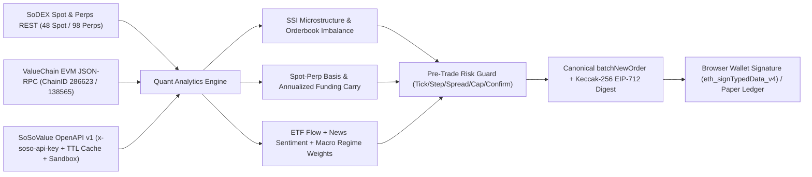

# SoSoSignal Desk

> **Agentic SSI Index Arbitrage, ETF Flow Regime & Risk-Gated SoDEX EIP-712 Execution Workbench**  
> Built for the **SoSoValue Buildathon (Wave 3)** on Akindo by **SoSoSignal Labs** (`@random-solver`).

- **Live Zero-Backend Web Demo:** https://random-solver.github.io/soso-signal-desk/
- **GitHub Repository:** https://github.com/random-solver/soso-signal-desk

---

## 1. Problem & User Value

Small quant teams and solo ("one-person business empire") traders face three operational gaps when bridging macro research to on-chain execution:

1. **Fragmented Insight vs. Execution:** ETF net inflows (`SoSoValue Terminal`), Spot Index pricing (`SSI Protocol`: `DEFI.ssi`, `USSI`, `MAG7.ssi`, `MEME.ssi`), and live orderbook liquidity (`SoDEX Spot & Perps` on `ValueChain`) live in separate tabs.
2. **Quota Exhaustion on Demo Keys:** SoSoValue Demo keys have tight request budgets (as low as 10–20 RPM), so naive dashboards burn through quota on every page refresh.
3. **Unsafe Signing & Precision Errors:** SoDEX write actions require strict decimal `tickSize` / `stepSize` validation, canonical Go-compatible JSON serialization for `payloadHash = keccak256(payload)`, and domain-separated **EIP-712** `ExchangeAction` hashing (`spot` / `futures`, Chain ID `286623` Mainnet / `138565` Testnet, `0x01` signature prefix).

**SoSoSignal Desk** unifies all three into a single deterministic workflow:
**Data Ingestion -> Signal Scoring -> Pre-Trade Risk Gate -> EIP-712 Action Digest & Paper Ledger.**

---

## 2. Architecture



---

## 3. Data & API Integration Coverage

| Integration | Endpoints / Methods Used | Auth / Mode |
|---|---|---|
| **SoSoValue OpenAPI v1** (`https://openapi.sosovalue.com/openapi/v1`) | `/etfs/summary-history`, `/indices`, `/indices/{ticker}/constituents`, `/news/hot`, `/macro/events` | `x-soso-api-key` + 5m TTL cache + `X-RateLimit-Remaining` tracking + zero-config Sandbox fallback |
| **SoDEX Spot API** (`https://mainnet-gw.sodex.dev/api/v1/spot`) | `/markets/symbols`, `/markets/tickers`, `/markets/{symbol}/orderbook`, `/markets/{symbol}/klines`, `/markets/{symbol}/trades` | Live unsigned REST (CORS `*`) covering `vDEFIssi_vUSDC`, `vUSSI_vUSDC`, `vMAG7ssi_vUSDC`, `vMEMEssi_vUSDC`, `WSOSO_vUSDC`, etc. |
| **SoDEX Perps API** (`https://mainnet-gw.sodex.dev/api/v1/perps`) | `/markets/symbols`, `/markets/tickers`, `/markets/{symbol}/orderbook`, annualized `fundingRate`, `markPrice` vs `indexPrice` | Live unsigned REST (CORS `*`) across all 98 perp contracts |
| **ValueChain EVM JSON-RPC** (`https://mainnet.valuechain.xyz` / `testnet.valuechain.xyz`) | `eth_chainId`, `eth_blockNumber`, `eth_gasPrice` | Live JSON-RPC state verification |
| **SoDEX EIP-712 Action Signing** | Canonical `batchNewOrder` JSON -> `Keccak-256` `payloadHash` -> `ExchangeAction` TypedData (`chainId` `286623` / `138565`, prefix `0x01`) | Browser Web3 wallet (`eth_signTypedData_v4`) or Paper Execution Ledger |

---

## 4. Quickstart & Verification (Zero Build Needed)

Requires **Node.js >= 20** (no external `npm install` runtime dependencies required — Keccak-256 & EIP-712 encoders are zero-dependency ES Modules).

```bash
git clone https://github.com/random-solver/soso-signal-desk.git
cd soso-signal-desk

# 1. Run unit tests + live SoDEX Mainnet & ValueChain RPC smoke tests
npm test

# 2. Run the live CLI signal scanner (supports --testnet and SOSO_API_KEY=...)
npm run scan

# 3. Serve the web dashboard locally (or visit the live GitHub Pages URL)
npx http-server . -p 4173 -c-1
```

---

## 5. Wave 3 Changelog (`Updates in this Wave`)

- Connected **all 4 live SoSoValue Spot Indices on SoDEX** (`vDEFIssi_vUSDC`, `vUSSI_vUSDC`, `vMAG7ssi_vUSDC`, `vMEMEssi_vUSDC`) plus `WSOSO_vUSDC` with live 24h klines, VWAP deviation, realized daily volatility, and top-5 L2 orderbook imbalance.
- Built the **98-Perp / 48-Spot Cross-Market Funding Carry & Basis Screener** normalizing SoDEX `v`-prefixed spot symbols (`vBTC` -> `BTC`, `vDEFI.ssi` -> `VDEFISSI`) against perpetual funding APR and spread cost.
- Implemented the **SoSoValue OpenAPI v1 client** with TTL caching, rate-limit header tracking (`X-RateLimit-Remaining`), optional browser `x-soso-api-key` persistence, and zero-key sandbox mode so judges can inspect every workflow immediately.
- Added **Pre-Trade Risk Controls** (`tickSize`, `stepSize`, `minNotional`, `maxNotionalUsd`, `maxSpreadBps`, explicit operator confirmation) feeding a **zero-dependency Keccak-256 & EIP-712 `ExchangeAction` Digest Builder**.
- Verified all unit tests and live SoDEX/ValueChain integration checks via `node --test tests/all.test.mjs`.

## License

MIT
